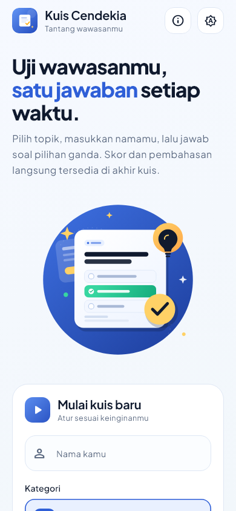
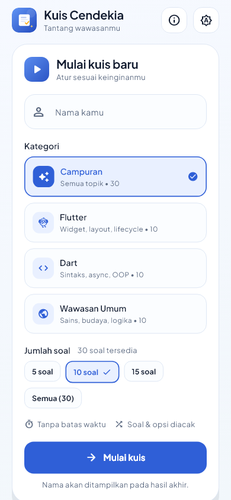
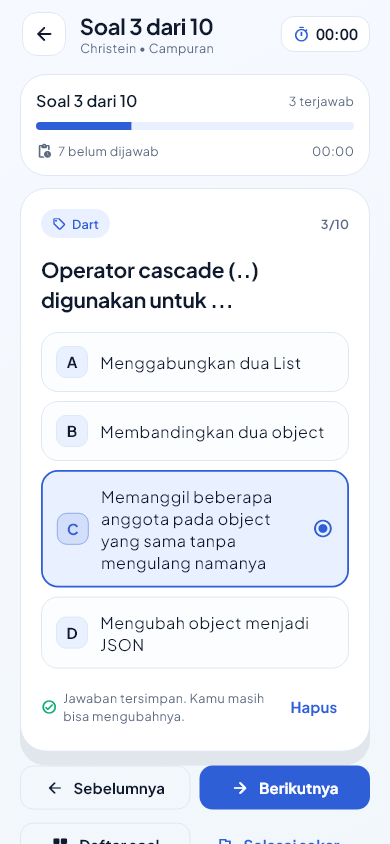
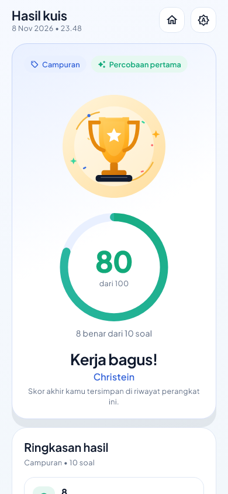
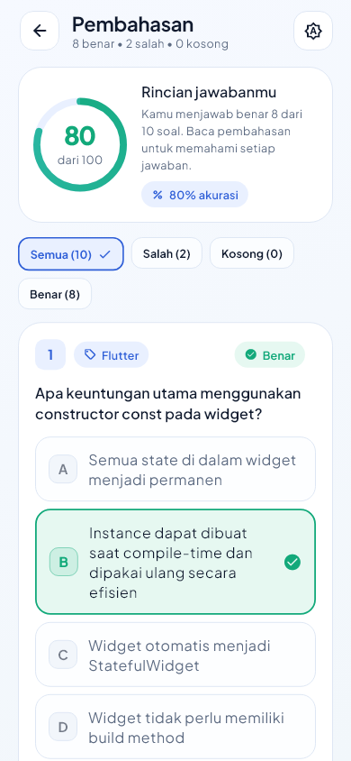
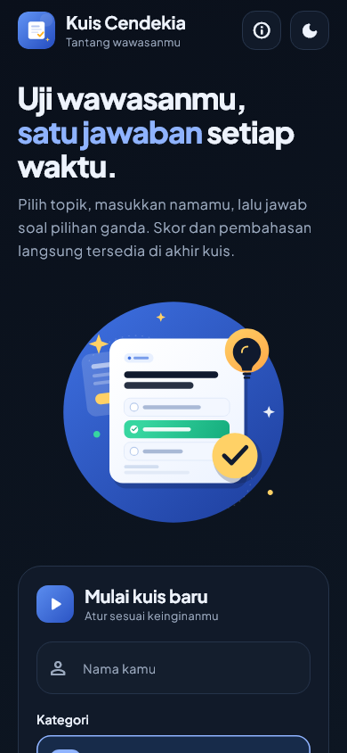
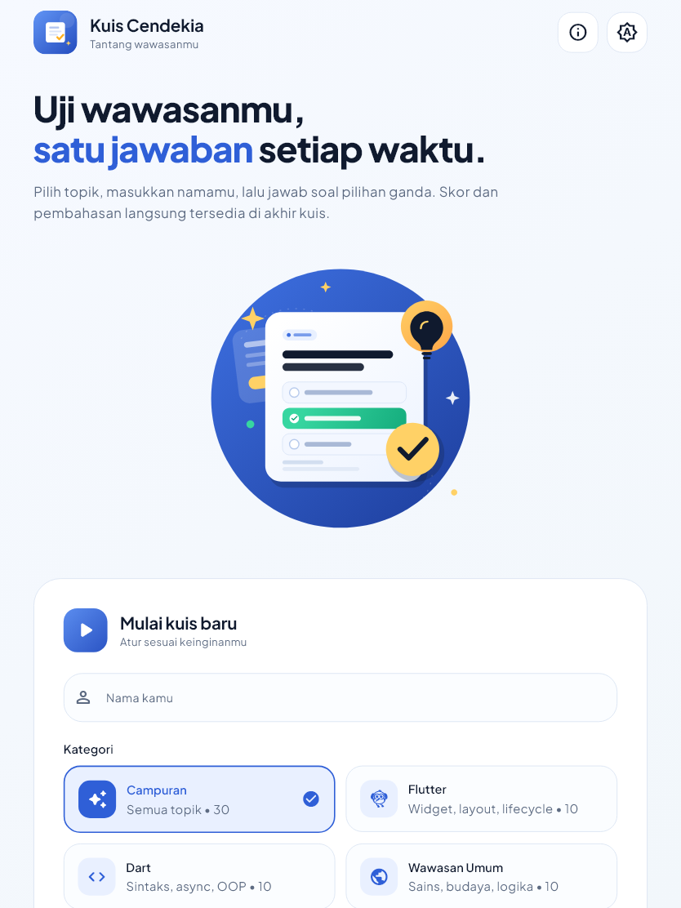
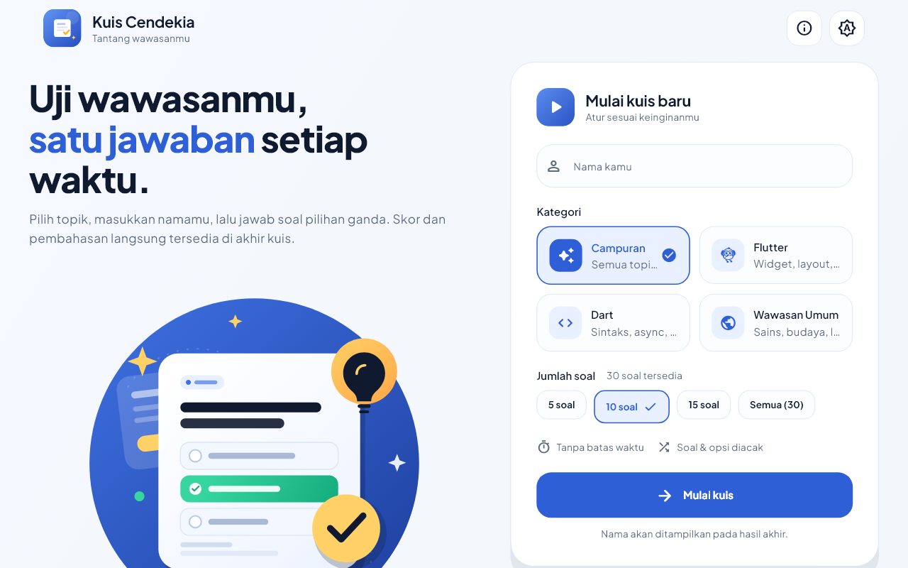
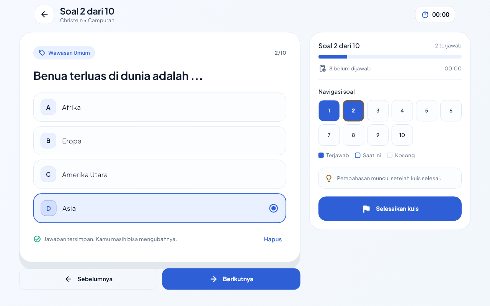
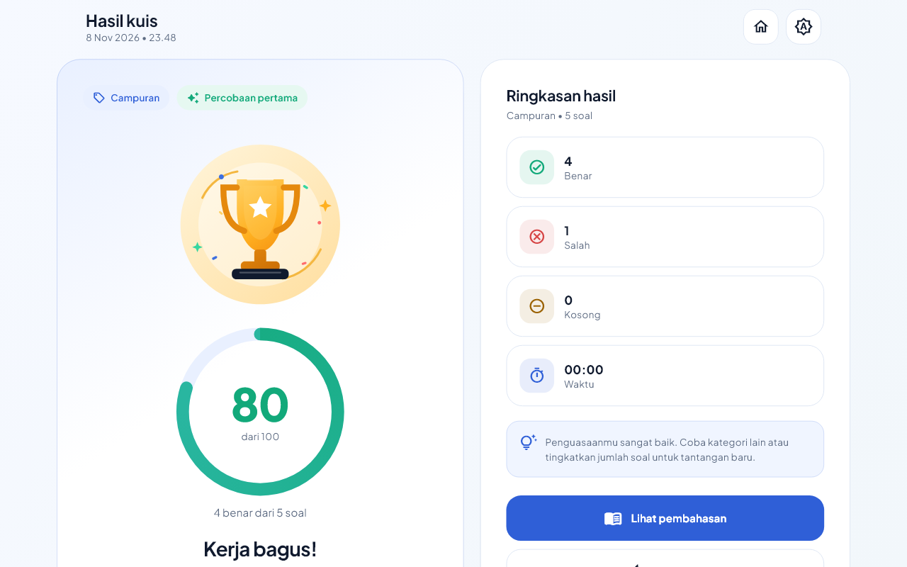

# Kuis Cendekia

Aplikasi kuis pilihan ganda berbasis Flutter untuk UTS Pemrograman Mobile.
Pengguna memasukkan nama, memilih kategori dan jumlah soal, menjawab soal,
lalu melihat skor akhir yang ditampilkan bersama nama pengguna tersebut.

---

## 1. Identitas Mahasiswa

| Keterangan | Isi                                      |
| --- |------------------------------------------|
| Nama | `Christein Akadojuanrich Habayaki Purba` |
| NIM | `241401012`                              |
| Lab | `5`                                      |
| Mata kuliah | Pemrograman Mobile (UTS)                 |
| Semester | Ganjil T.A. 2026/2027                    |

---

## 2. Informasi Aplikasi

**Nama aplikasi:** Kuis Cendekia

**Deskripsi singkat:**
Kuis Cendekia adalah aplikasi kuis pilihan ganda dengan 30 soal lokal yang
dibagi ke dalam tiga kategori: Flutter, Dart, dan Wawasan Umum. Pengguna
menuliskan nama, memilih kategori serta jumlah soal, lalu menjawab soal satu
per satu. Skor akhir dihitung dari jawaban benar dan ditampilkan bersama nama
pengguna. Aplikasi juga menyediakan pembahasan jawaban, riwayat skor lokal,
mode gelap/terang, dan tata letak responsif untuk ponsel, tablet, serta web.

**Fitur yang tersedia:**

- Input nama dengan validasi (nama wajib diisi, spasi dirapikan).
- Pilihan kategori: Campuran, Flutter, Dart, Wawasan Umum.
- Pilihan jumlah soal: 5, 10, 15, atau semua soal yang tersedia.
- Soal dan opsi jawaban diacak; setiap kategori berisi 10 soal (total 30).
- Navigasi soal: Sebelumnya, Berikutnya, dan palet nomor soal.
- Indikator progres, jumlah soal terjawab, dan timer durasi pengerjaan.
- Jawaban dapat diubah atau dihapus sebelum kuis diselesaikan.
- Konfirmasi sebelum keluar atau menyelesaikan kuis.
- Skor akhir personal: nama, jumlah benar/salah/kosong, persentase, dan pesan.
- Pembahasan setiap soal beserta filter Semua/Benar/Salah/Kosong.
- Riwayat skor tersimpan lokal (maksimal 20 entri) dan penanda rekor.
- Melanjutkan kuis yang belum selesai setelah kembali ke beranda.
- Mode gelap dan terang, tersimpan di perangkat.
- Tata letak adaptif: satu kolom di ponsel, dua kolom di tablet/web lebar.

**Bonus yang dikerjakan:**

- Dual-theme (light & dark mode) dengan animasi transisi.
- Adaptive & responsive design untuk tablet dan browser/web.

---

## 3. Alur Aplikasi

```
Beranda (/)
  ├─ isi nama, pilih kategori & jumlah soal
  ├─ Mulai kuis ──────────────► Kuis (/quiz)
  │                              ├─ jawab soal / palet / timer
  │                              ├─ keluar (progres disimpan, bisa dilanjutkan)
  │                              └─ selesai ─► Hasil (/result)
  │                                             ├─ Lihat pembahasan ─► Pembahasan (/review)
  │                                             └─ Ulangi kuis ──────► Kuis (/quiz)
  └─ riwayat skor, ubah tema, tentang aplikasi
```

Navigasi memakai named route (`AppRoutes`) dengan transisi fade + slide.
Controller berada di atas `MaterialApp`, sehingga progres kuis tetap ada saat
rotasi layar maupun saat berpindah halaman.

---

## 4. Teknologi dan Struktur Proyek

- Flutter 3.47.2 / Dart 3.13.2
- `provider` — state management (`QuizController`, `ThemeController`,
  `HistoryController`)
- `shared_preferences` — penyimpanan lokal tema dan riwayat skor
- `flutter_svg` — menampilkan ilustrasi SVG
- Tanpa database dan tanpa API jaringan; seluruh soal berada di
  `lib/data/data/question_bank.dart`

```
lib/
├── main.dart                  # komposisi controller + runApp
├── app.dart                   # MaterialApp, theme, routing
├── core/
│   ├── routing/app_router.dart
│   ├── theme/                 # AppTheme, AppColors, AppPalette
│   └── utils/                 # responsive.dart, formatters.dart
├── data/
│   ├── models/                # Question, QuizSettings, QuizResult
│   └── data/question_bank.dart# 30 soal lokal
├── services/                  # settings_store, history_repository
├── state/                     # quiz, theme, history controller
├── screens/                   # home, quiz, result, review
└── widgets/                   # 13 widget reusable
```

**Widget reusable** (masing-masing di file terpisah):
`AppButton`, `AppCard`, `AppBadge`, `AppTopBar`, `AppBackground`,
`NameField`, `CategorySelector`, `QuizLengthSelector`, `OptionTile`,
`QuizProgress`, `ScoreRing`, `AnswerReviewCard`, `HistoryPanel`,
`EmptyState`, dan dialog konfirmasi.

**StatelessWidget vs StatefulWidget:**

- `StatelessWidget`: `KuisCendekiaApp`, seluruh widget di `lib/widgets/`,
  `ResultPage`, serta sebagian besar isi halaman.
- `StatefulWidget`: `HomePage` (form, fokus input, dialog),
  `QuizPage` (timer UI, dialog keluar, scroll), `ReviewPage` (filter
  jawaban), dan widget animasi/theme.

**Ukuran dinamis:**

- `context.rs()` menskalakan ukuran berdasarkan sisi terpendek layar.
- `context.responsive()` memilih nilai compact/medium/expanded.
- Breakpoint `compact < 600`, `medium < 1040`, `expanded >= 1040`
  (lihat `lib/core/utils/responsive.dart`).
- Tidak ada lebar/tinggi layout utama yang di-hardcode per perangkat.

---

## 5. Aset dan Kredit

| Aset | Sumber / lisensi | Lokasi |
| --- | --- | --- |
| Font **Plus Jakarta Sans** (400, 500, 600, 700, 800) | Tokotype — SIL Open Font License 1.1 | `assets/fonts/` dan `assets/fonts/OFL.txt` |
| Ikon **Material Icons** | Google — Apache License 2.0, disertakan melalui `uses-material-design: true` | dipakai lewat widget `Icon` |
| Ilustrasi **hero_quiz.svg**, **trophy.svg**, **logo_mark.svg**, **empty_history.svg** | Dibuat khusus untuk proyek ini (tidak mengambil aset pihak ketiga) | `assets/images/` |
| Paket `provider`, `shared_preferences`, `flutter_svg` | Pub.dev — lisensi BSD-3-Clause | `pubspec.yaml` |

Jika ilustrasi diganti dengan aset dari internet, cantumkan sumber dan
lisensinya pada tabel ini.

---

## 6. Cara Menjalankan

```bash
flutter pub get
flutter run -d chrome        # web
flutter run                  # Android/desktop yang tersedia
```

Build web:

```bash
flutter build web --release
python -m http.server 8080 -d build/web
# buka http://localhost:8080
```

Pengujian:

```bash
flutter analyze
flutter test
```

> Catatan lingkungan: pada Windows, build desktop dengan plugin
> `shared_preferences` memerlukan Developer Mode/symlink support. Build web
> tidak memerlukan itu.

---

## 7. Screenshot Setiap Halaman

Semua screenshot di bawah merupakan render widget aplikasi pada ukuran tetap
(devicePixelRatio 1).

### 7.1 Beranda — ponsel (390 × 844)



### 7.2 Beranda — form nama, kategori, jumlah soal (390 × 844)



### 7.3 Kuis — soal terjawab (390 × 844)



### 7.4 Hasil — skor personal (390 × 844)



### 7.5 Pembahasan — filter jawaban (390 × 844)



### 7.6 Beranda — mode gelap (390 × 844)



### 7.7 Beranda — tablet (834 × 1112)



### 7.8 Beranda — desktop/web (1280 × 800)



### 7.9 Kuis — desktop/web (1280 × 800)



### 7.10 Hasil — desktop/web (1280 × 800)



---

## 8. Catatan Presentasi

Link Presentasi: https://youtu.be/tkHu07I9DVI


---

## 9. Hasil Verifikasi

Output saat pengembangan terakhir:

```text
$ flutter analyze
Analyzing UTS_PM5_Christein...
No issues found!

$ flutter test
00:13 +17: All tests passed!

$ flutter build web --release
√ Built build\web
```

Cakupan tes otomatis (17 tes):

- `test/quiz_controller_test.dart` — validasi nama, filter kategori, jawaban,
  skor, pengacakan opsi, reset.
- `test/history_controller_test.dart` — penyimpanan, urutan, rekor, batas 20.
- `test/widget_test.dart` — validasi form, rotasi + resume, hasil personal,
  pembahasan, tema gelap, responsif 320/390/768/1280 tanpa overflow.


---

## 10. Checklist Kesesuaian Soal UTS

| No | Kriteria | Status | Bukti |
| --- | --- | --- | --- |
| 1 | StatelessWidget & StatefulWidget sesuai kebutuhan | Terpenuhi | `lib/app.dart`, `lib/screens/home_page.dart`, `lib/screens/quiz_page.dart`, `lib/widgets/` |
| 2 | Minimal 2 halaman + navigasi | Terpenuhi | 4 halaman di `lib/screens/`, named route `lib/core/routing/app_router.dart` |
| 3 | Widget reusable di file terpisah | Terpenuhi | 13+ widget di `lib/widgets/` |
| 4 | Aset gambar/ikon | Terpenuhi | 4 SVG di `assets/images/`, Material Icons |
| 5 | Font kustom | Terpenuhi | Plus Jakarta Sans 5 weight di `pubspec.yaml`, `assets/fonts/` |
| 6 | Ukuran UI dinamis/responsif | Terpenuhi | `lib/core/utils/responsive.dart`, tes 320–1280 px |
| 7 | State management menjaga progres saat rotasi/navigasi | Terpenuhi | `lib/state/quiz_controller.dart`, tes “progress survives rotation…” |
| 8 | Data lokal/dummy tanpa database | Terpenuhi | `lib/data/data/question_bank.dart` (30 soal) |
| 9 | Commit GitHub per fitur | Terpenuhi | riwayat commit terpisah per fitur (lihat `git log --oneline`) |
| 10 | Desain menarik dan fitur lengkap | Terpenuhi | tema, ilustrasi, animasi, pembahasan, riwayat, timer |
| B1 | Bonus dual-theme | Terpenuhi | `lib/state/theme_controller.dart`, `lib/core/theme/` |
| B2 | Bonus adaptive & responsive tablet/web | Terpenuhi | breakpoint + screenshot tablet/web 834/1280 px |

---
